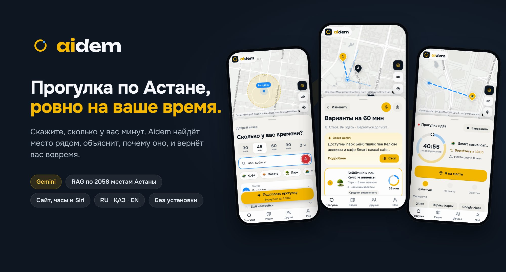
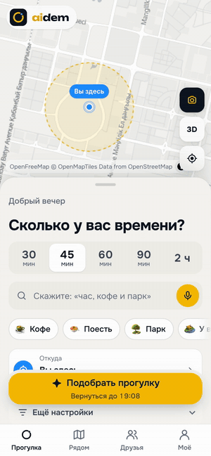
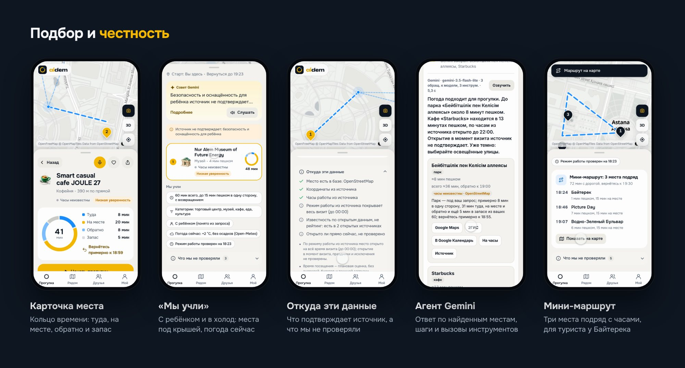
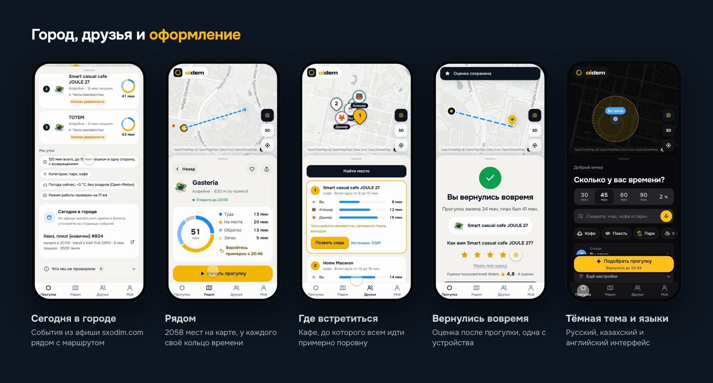
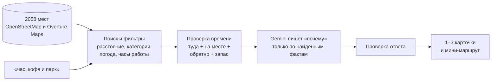

<p align="center">
  <a href="https://ascension-smartwalk.azamatbreach.workers.dev"></a>
</p>

<p align="center">
  <a href="https://ascension-smartwalk.azamatbreach.workers.dev"></a>
  <a href="https://ascension-smartwalk.azamatbreach.workers.dev/watch"></a>
  <a href="https://ascension-smartwalk.azamatbreach.workers.dev/agent"></a>
  <a href="#видео"></a>
  <a href="deliverables/ascension-smartwalk-presentation.pdf"></a>
  <a href="deliverables/ascension-smartwalk-tests-and-limitations.pdf"></a>
</p>

**Aidem** подсказывает, куда сходить в Астане, когда у вас есть немного времени. Скажите «час, кофе и парк», и Aidem найдёт место рядом, объяснит, почему именно оно, и посчитает, когда вы вернётесь. Работает в браузере телефона, на часах и через Siri. Ставить ничего не нужно, регистрироваться тоже.

Команда **Ascension** · Build with AI Hackathon 2026, GDG Astana · кейс НИЦ Smart City «ИИ-помощник по прогулкам в городе Астана». Aidem (ранее SmartWalk): прежнее имя осталось в адресе сайта и репозитория.

## Для жюри: всё в одном месте

| | Что | Ссылка |
|---|---|---|
| 🌐 | Работающее демо, телефон или компьютер | [ascension-smartwalk.azamatbreach.workers.dev](https://ascension-smartwalk.azamatbreach.workers.dev) |
| 🎬 | Видео, 3:41 | [скачать MP4](deliverables/video/aidem-final.mp4) · [YouTube](#видео) |
| 📊 | Презентация, 14 слайдов на 6 минут | [PDF](deliverables/ascension-smartwalk-presentation.pdf) · [живая версия с анимацией](deliverables/deck/) |
| 🧪 | Тестовые сценарии и ограничения | [PDF](deliverables/ascension-smartwalk-tests-and-limitations.pdf) · [протокол 15 сценариев](docs/test-protocol.md) |
| 💡 | Концепция, аудитория, бизнес-идея, риски, план | [docs/concept.md](docs/concept.md) |
| 🔒 | Этика и приватность | [docs/ethics.md](docs/ethics.md) |
| 🧭 | Как работает RAG | [docs/how-it-works.md](docs/how-it-works.md) |
| ⌚ | Часы и Siri | [/watch](https://ascension-smartwalk.azamatbreach.workers.dev/watch) · [docs/watch.md](docs/watch.md) |
| 🤖 | Агент Gemini, MCP, ADK | [/agent](https://ascension-smartwalk.azamatbreach.workers.dev/agent) · [docs/integrations.md](docs/integrations.md) |
| 🚀 | Как запустить и задеплоить | [docs/deploy.md](docs/deploy.md) |

## Зачем это

У студента между парами 45 минут. У туриста два часа до вылета. У мамы с ребёнком час, пока не стемнело. Карты показывают сотни мест, но не отвечают на главный вопрос: успею ли я сходить и вернуться?

Aidem начинает именно со времени. Каждая карточка уже посчитана целиком: дорога туда, время на месте, дорога обратно и запас, который вы выбрали сами. Если времени хватает, Aidem предлагает мини-маршрут из трёх мест подряд. А во время прогулки кольцо на экране показывает, сколько осталось до возвращения, и вовремя напоминает «пора обратно».

Все места взяты из открытых данных, которые мы собрали скриптами: 2058 мест Астаны из OpenStreetMap и Overture Maps. Объяснение пишет Gemini, но только по найденным фактам. Чего источник не знает, Aidem так и говорит.

## Попробуйте за минуту



1. Откройте [демо](https://ascension-smartwalk.azamatbreach.workers.dev) на телефоне и разрешите геопозицию. Можно и без неё: старт выбирается на карте.
2. Нажмите на микрофон и скажите «час, кофе и парк» или выберите время и напишите запрос.
3. Откройте карточку: там видно, сколько идти туда, сколько быть на месте и когда вы вернётесь.
4. Нажмите «Начать прогулку». Кольцо времени покажет, когда пора обратно.

Запросы из задания тоже работают:

- «Я сейчас возле Mega Silk Way, хочу прогуляться 30–60 минут»
- «Хочу тихое место с кофе и розеткой недалеко от меня»
- «Еду с ребёнком, где рядом площадка или музей с интерактивом?»
- «Я турист, у меня 2 часа перед вылетом»
- «Ищу необычную ночную активность»

<br clear="right">

## Что умеет



**Подбор ровно на ваше время.** От одного до трёх вариантов, и каждый помещается в выбранные минуты вместе с дорогой обратно. Запас 5, 10 или 15 минут вы выбираете сами. Часы работы проверяются на всё время визита, а не только на момент выхода. В дождь, снег, мороз или сильный ветер обычный запрос подбирает места под крышей.

**Понимает, кто вы и с кем.** «С ребёнком» подбирает площадки, семейные места и музеи. «Турист» ставит вперёд достопримечательности: у Байтерека первым будет сам Бәйтерек. «Нас четверо» убирает фастфуд, «на коляске» учитывает доступность из OpenStreetMap, «ночью» проверяет, что место ещё работает. Если словарь не узнал слова («подышать свежим воздухом»), запрос понимают эмбеддинги Gemini.

**Объясняет и не выдумывает.** У каждой карточки есть короткое «почему» и «что делать», строка «чем это лучше других» только по подтверждённым фактам, уровень уверенности и блок «Что мы не проверяли». Блок «Мы учли» показывает, что система поняла из запроса: время, категории, ребёнка, погоду. Если в пределах времени ничего нет, Aidem называет ближайшее подходящее место и что поменять.

**Ваши правила.** «Больше не предлагать» убирает место из следующих подборов, а «Удиви меня» выбирает случайное, но только среди тех, что прошли все проверки.



**Город сегодня.** Под вариантами прогулки видны события из афиши [sxodim.com](https://sxodim.com/astana/afisha), до которых можно дойти пешком. Афишу сервер собирает сам каждое утро.

**Друзья и встречи.** Можно показать друзьям, где вы, на 15 минут, час или 8 часов, и только по согласию. «Где встретиться» находит кафе, до которого всем идти примерно поровну. Подробнее: [docs/friends.md](docs/friends.md).

**Оценки, которые никто не придумал.** После прогулки можно поставить от 1 до 5 звёзд, одна оценка с устройства. Среднее показывается от трёх оценок, а на порядок выдачи оценки влияют слабо и только от пяти. Известность по открытым данным подписана отдельно: «это не рейтинг».

**Голосом, на трёх языках, на часах.** Голос без рук: после ответа можно сказать «второй», «поехали» или «а на полчаса?». Сайт, часы, вкладка «Друзья» и страница агента работают на русском, казахском и английском, и ответы Gemini приходят на языке вопроса. На часах (`/watch`, Apple Watch и Wear OS) есть стрелка к месту, кольцо времени и напоминание «пора обратно», поиск по названию с учётом выбранного времени, а быстрая команда Siri отвечает на «Куда сходить?». Время на часах и во встречах всегда по Астане, в каком бы поясе ни был телефон. Подробнее: [docs/watch.md](docs/watch.md).

**Google и ИИ.** Ответы и объяснения пишет Gemini. На странице `/agent` агент Gemini сам вызывает инструменты (погода, подбор, поиск, мини-маршрут) и показывает каждый шаг понятной строкой: какой инструмент, что сделал и что получил. «Что это за здание?» распознаёт фото, а ответ можно послушать голосом Gemini. Те же инструменты доступны через MCP-сервер, расширение Gemini CLI и агента на Google ADK. У каждого места есть ссылки на Google Maps, 2ГИС и Google Календарь. Подробнее: [docs/integrations.md](docs/integrations.md).

Все функции с деталями и API: [docs/features.md](docs/features.md).

## Как это работает

Сначала код находит места в собранной базе и проверяет время, часы работы и погоду. Потом Gemini пишет объяснение, но получает только найденные записи и рассчитанное время. Ответ проверяется: текст с числом, которого нет в данных, или с обещанием вроде «открыто сейчас» отбрасывается, и остаётся рассчитанное объяснение.



Пять шагов RAG, сбор данных и лицензии: [docs/how-it-works.md](docs/how-it-works.md).

## Честность и приватность

- **Точная точка остаётся на телефоне.** Сервер получает клетку примерно 110×70 м, а в Gemini координаты не уходят совсем.
- **История не хранится.** Ни координат, ни запросов. Друзья видят вас только по согласию и на выбранный срок.
- **Источник у каждого факта.** Карточка показывает, что взято из OpenStreetMap или Overture, что посчитано, а что написала модель.
- **Описания из тегов, без выдумок.** Короткое описание места собрано из категории и тегов источника; у многих мест это одно слово, потому что больше источник ничего не знает.
- **Неизвестное названо неизвестным.** «Часы неизвестны», «Низкая уверенность», «безопасность для ребёнка источник не подтверждает».

Подробно: [docs/ethics.md](docs/ethics.md).

## Соответствие заданию

| Что просили | Где это у нас |
|---|---|
| Концепция: идея, аудитория, сценарии | [docs/concept.md](docs/concept.md) и первые слайды презентации |
| Демо на нескольких сценариях | [живой сайт](https://ascension-smartwalk.azamatbreach.workers.dev), часы, агент; [видео](#видео) |
| Описание RAG-подхода | [docs/how-it-works.md](docs/how-it-works.md) |
| Тестовые сценарии: вход и ожидаемый ответ | [PDF](deliverables/ascension-smartwalk-tests-and-limitations.pdf), [протокол](docs/test-protocol.md): 6 из задания и 9 своих, 15 из 15 Pass |
| Презентация на 5–7 минут: бизнес, ограничения, риски, план | [PDF](deliverables/ascension-smartwalk-presentation.pdf), [docs/concept.md](docs/concept.md) |
| Этика и приватность | [docs/ethics.md](docs/ethics.md) |
| Данные собраны автоматически | `scripts/import_osm_pois.py`, `scripts/fetch_overture.py`, `scripts/build_places.py`, афиша собирается Worker каждый день |
| 1–3 пункта с «почему», временем и «что делать» | каждая карточка; проверяется в `tests/scenarios.test.mjs` |
| Не обещать «открыто сейчас» без данных, указывать уверенность | уровень уверенности, «Что мы не проверяли», проверка ответа модели |
| Помечать источник: данные POI или сгенерированная идея | метки происхождения у каждого текста |
| Стретч-цели: группа, мини-маршрут, языки, события, доступность | «нас четверо», мини-маршрут из 3 мест, RU · ҚАЗ · EN, «Сегодня в городе», «на коляске» |

## Запуск и деплой

```sh
npm install
npm test        # автотесты, без сети и без ключей
npm run dev     # http://localhost:8789, ключ Gemini в GEMINI_API_KEY по желанию
```

Демо работает на Cloudflare Workers (бесплатный тариф):

```sh
npm run build && npx wrangler deploy     # ключ один раз: npx wrangler secret put GEMINI_API_KEY
```

Друзья, напоминания для часов и афиша поднимаются сами, а проверить деплой можно по `/api/status`. Пошагово, с Google Cloud Run и списком настроек: [docs/deploy.md](docs/deploy.md).

## Видео

<!-- VIDEO-LINK: заменить строку ниже ссылкой YouTube, когда ролик загружен -->
Ролик на 3:41: сайт, телефон и часы в работе, озвучивает команда.

**[Скачать видео (MP4, 85 МБ)](deliverables/video/aidem-final.mp4)** · ссылка на YouTube появится здесь, как только ролик загрузится.
<!-- /VIDEO-LINK -->

## Что в репозитории

```text
src/            сервер: подбор (retrieval), понимание запроса (intent), Gemini, агент, MCP, часы, друзья, афиша
public/         приложение: сайт, /watch, /agent
data/           собранная база мест, снимки источников, отчёты о слиянии, копия афиши
scripts/        сбор данных, сборка, локальный сервер, протокол сценариев и его PDF
tests/          автотесты (npm test), включая сценарии из задания на полной базе
integrations/   агент на Google ADK
docs/           концепция, этика, RAG, функции, деплой, часы, интеграции, протокол
deliverables/   видео, презентация (PDF и живая), PDF сценариев и ограничений, START-HERE
archive/        материалы первой сдачи: старый ролик, скриншоты, сборщики
```

## Команда Ascension

Азамат ([@Azalytical](https://github.com/Azalytical)), Алишер и Данияр. Build with AI Hackathon 2026, Астана.

## In English

**Aidem** is a walking assistant for Astana built for the GDG Astana Build with AI Hackathon 2026 (Smart City case). Tell it how much time you have and what you feel like, for example "an hour, coffee and a park", and it suggests one to three places nearby that fit the whole trip: there, the visit, back, and a safety reserve you choose. It is a RAG system: places come from 2,058 Astana venues we collect automatically from OpenStreetMap and Overture Maps, the code checks distance, opening hours and weather, and Gemini writes the explanation from those facts only. Answers that add numbers or promises the data does not support are rejected. The exact location stays on the phone. Try it at [ascension-smartwalk.azamatbreach.workers.dev](https://ascension-smartwalk.azamatbreach.workers.dev); the interface also works in Kazakh and English, on a watch (`/watch`) and with a Gemini agent that shows its tool calls (`/agent`). Run it locally with `npm install && npm run dev`; deploy notes are in [docs/deploy.md](docs/deploy.md).

## Данные и лицензии

Данные © OpenStreetMap contributors ([ODbL 1.0](https://www.openstreetmap.org/copyright)) и Overture Maps Foundation ([условия](https://docs.overturemaps.org/attribution/)); у каждой записи своя лицензия в поле `source`. События принадлежат [sxodim.com](https://sxodim.com/astana/afisha), у каждого есть ссылка на его страницу. Код приложения под [MIT](LICENSE).
