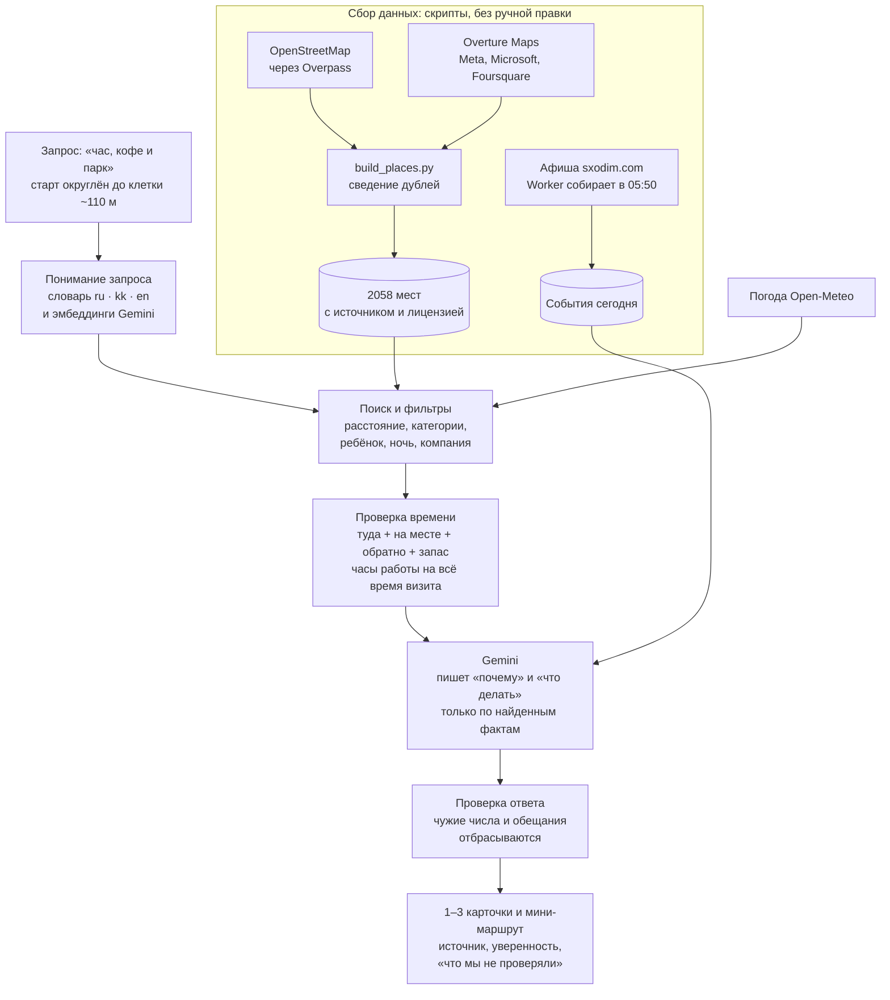

# Как работает Aidem

Aidem отвечает на вопрос «куда сходить, если у меня есть N минут». Ответ собирается в два слоя. Сначала код находит места в собранной базе и проверяет время, часы работы и погоду. Потом Gemini пишет объяснение, но только по тем фактам, которые код ему передал. Это и есть RAG: генерация опирается на извлечённые записи, а не на память модели.

## Пять шагов

1. **Сбор.** `scripts/import_osm_pois.py` получает места из OpenStreetMap через Overpass и нормализует их. `scripts/fetch_overture.py` берёт из публичного бакета Overture Maps только части файлов, которые пересекают Астану. `scripts/build_places.py` объединяет источники в `data/places.json`: записи OSM в приоритете, совпавшее место из Overture только дополняет пустые контакты, и у каждого поля указан источник. В базе 2255 записей; после сведения дублей на карте и в подборе 2058 мест. Отчёт по слиянию: `data/places-report.json`.
2. **Поиск.** Детерминированный поиск выбирает записи по категории, тексту, намерениям запроса (`src/intent.mjs`), расстоянию и текущей погоде (`src/weather.mjs`). Если словарь ru/kk/en не нашёл в запросе ни одной категории («хочу подышать свежим воздухом»), эмбеддинги Gemini (`gemini-embedding-001`) сравнивают запрос с примерами для каждой категории (`src/semantic.mjs`). В модель уходит только текст запроса. Если вызов не удался или не уложился в 1,2 секунды, подбор идёт по словарю.
3. **Проверка.** Валидатор отбрасывает варианты, которые не помещаются во время, и места, закрытые на время визита по режиму работы из источника (`src/hours.mjs`). Из оставшихся строится мини-маршрут из трёх мест с проверкой часов на время прихода к каждому (`src/route.mjs`).
4. **Генерация.** Модель получает только найденные записи, запрос, то, что система из него поняла, и рассчитанное время. Gemini пишет общий вывод и для каждого места своё «почему» и «что делать». Идентификаторы источников сверяются, а текст с неподтверждённым утверждением («открыто сейчас», «вход бесплатный», «абсолютно безопасно») или с числом, которого нет в данных этого места, отбрасывается. Тогда у карточки остаётся рассчитанное «почему». Время модель не меняет.
5. **Показ.** Карточка показывает факты источника, расчёт и текст модели раздельно, с меткой происхождения каждого, уровнем уверенности и списком «что мы не проверяли».

Агент Gemini на `/agent` идёт тем же путём, только инструменты (погода, подбор, поиск, карточка, мини-маршрут) выбирает сама модель через function calling, и каждый шаг виден на экране. Подробно: [integrations.md](integrations.md).

## Честность и приватность

- **Точка остаётся на устройстве.** Браузер отправляет на сервер клетку примерно 110×70 м, а не точные координаты. Сервер ещё раз округляет точку из Siri, агента и фото. В Gemini точка не уходит вообще.
- **Ничего не хранится.** Сервер не ведёт историю координат и запросов. Друзья видят точку только по согласию и на выбранный срок; хранится одна последняя точка.
- **Неизвестное называется неизвестным.** Часы работы — сведения источника, а не «открыто сейчас». Тишина, розетки, очереди и безопасность не предполагаются. «С ребёнком» меняет категории, но не подтверждает оснащённость места.
- **Оценки настоящие.** Звёзды ставят пользователи Aidem, одна оценка с устройства; среднее показывается от трёх оценок. Известность по открытым данным (Wikidata, несколько источников) подписана «это не рейтинг».
- **Модель видна.** Текст Gemini подписан «Сгенерировано Gemini только по найденным местам», агент показывает модель и число обращений, а ответ без модели так и помечен.

Полностью: [ethics.md](ethics.md).

## Ограничения

- Пешеходная навигация не строится. Расстояние и время — оценки: прямая, коэффициент обхода 1,35, скорость 4,2 км/ч. Ограждения, переходы, погода и свой темп меняют время.
- События города берутся из афиши sxodim.com на момент утреннего сбора. Время, отмену и билеты нужно уточнять на странице события.
- На публичном демо работает бесплатный ключ Gemini API: Google может использовать такие запросы для улучшения продуктов, поэтому личные данные в запросе писать не стоит. Для реального запуска нужен ключ проекта с биллингом.
- Запросы к модели на демо ограничены: до 8 в минуту с одного адреса и до 500 в сутки. Сверх лимита поиск продолжает работать без модели.

## Данные и лицензии

Данные © OpenStreetMap contributors, [ODbL 1.0](https://www.openstreetmap.org/copyright), и Overture Maps Foundation ([условия и источники](https://docs.overturemaps.org/attribution/)): места от Meta, Microsoft и PinMeTo по CDLA-Permissive-2.0, от Foursquare по Apache-2.0, от AllThePlaces по CC0-1.0. Объекты OSM из тем Overture base и buildings остаются под ODbL. Лицензия каждой записи указана в её поле `source`; производная база распространяется под ODbL. Название, дата, площадка и цена события принадлежат sxodim.com, у каждого события есть ссылка на его страницу. Код приложения и скрипты публикуются под MIT, см. [LICENSE](../LICENSE).
